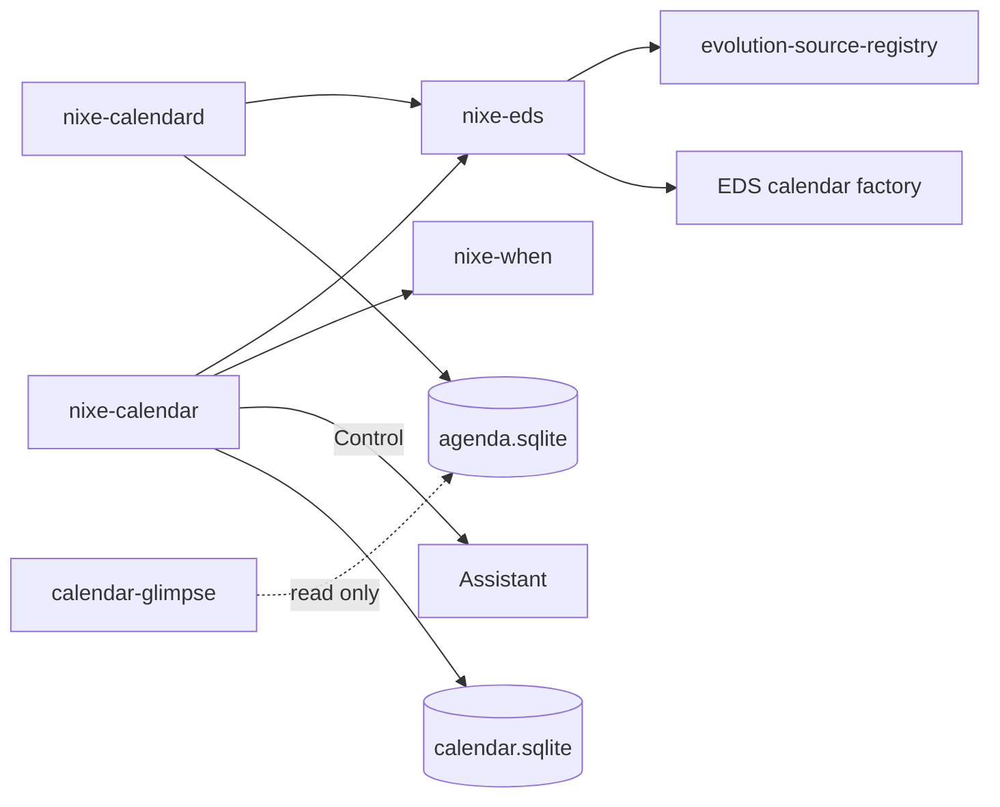

# Calendar architecture

## Sources

`nixe-eds::Registry` lists calendar sources with their GOA account, color, visibility
and read-only flag. Color and visibility changes are written through `ESource` APIs, not
by editing files. "On this computer" is EDS's local calendar.

## Events

- Views ask `ECalClient` for instances in the visible range (`generate_instances`), so
  recurrence, exceptions and time zones come from libical.
- Edits go through `create/modify/remove` with the recurrence modifier chosen by the user
  (this, this and following, all).
- EDS keeps the offline cache and queues changes made offline; the status bar reports
  when a calendar is offline or has pending changes.
- `ECalClientView` signals refresh the visible range when a sync brings changes.

## Local data (`calendar.sqlite`)

| Table | Holds |
| --- | --- |
| `sets` | Calendar Sets: name, ordered source uids |
| `working_hours` | Per weekday ranges, time zone |
| `quick_history` | Recent quick-create phrases and their parse |

Event data is never copied here.

## `nixe-calendard`

A GTK-free user service. It runs `EReminderWatcher`, sends notifications (one per alarm,
with Snooze and Dismiss), and rewrites `agenda.sqlite` (±60 days, title, time, calendar,
location, meeting link) when calendars change. If `evolution-alarm-notify` is running it
does not notify, to avoid duplicates.

D-Bus `io.github.design_nexus.nixe.CalendarEngine1`: `Agenda(from, to)`,
`FreeBusy(from, to, sources)`, `QuickCreate(text) → preview`.

## Control tools

Reads: `calendar.list`, `calendar.next`, `calendar.read`, `calendar.search`,
`calendar.free_slots`. Edits (always confirmed in Assistant): `calendar.create`,
`calendar.edit`, `calendar.delete`, `calendar.suggest_reschedule`.

## Failure states

| State | Shown as |
| --- | --- |
| EDS not installed | Banner: install `evolution-data-server` |
| EDS not answering (timeout) | Banner: calendar data isn't available; retry |
| GOA account needs sign-in | Banner on that account's calendars; opens Settings |
| Offline | Status bar readout; cached events stay visible and editable |
